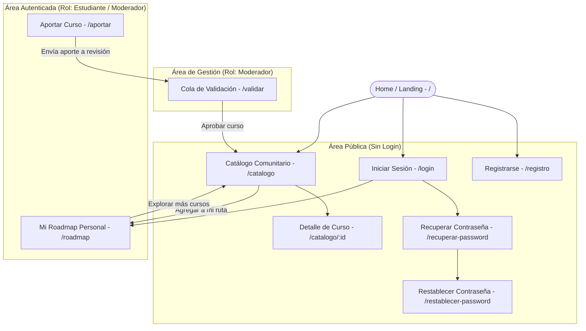
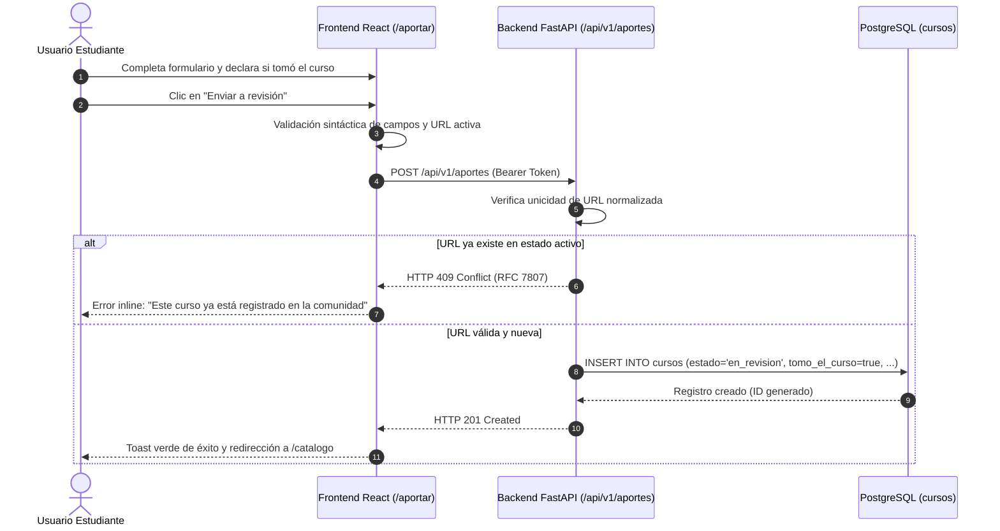
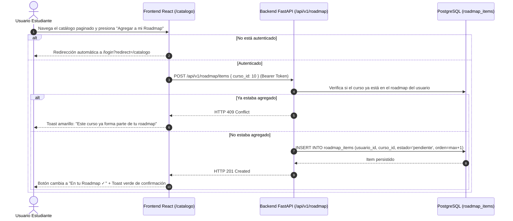

# APPFlow — Mapa del Sitio, Rutas y Flujos de Usuario — OpenRoadmap

> **Qué es este documento:** Modela la arquitectura de información y los flujos de interacción de **OpenRoadmap**: sitemap jerárquico, tabla exhaustiva de rutas con control de acceso por roles, fichas técnicas por pantalla (con estados loading/empty/error y endpoints asociados) y flujos de usuario de punta a punta.
> **Regla de oro de coherencia:** Todo endpoint consumido en este documento existe de forma idéntica en `BackendSchema.md`; cada componente visual referencia tokens definidos en `UX-UI.md`; cada pantalla atiende a una historia de usuario de `PRD.md`.

---

## 1. Sitemap Jerárquico



---

## 2. Tabla Maestra de Rutas y Permisos

| Ruta Frontend | Pantalla / Módulo | Acceso / Rol Requerido | Endpoint Backend Principal Consumido | Notas de Redirección |
|---------------|-------------------|------------------------|--------------------------------------|----------------------|
| `/` | Landing / Presentación | Público (Visitante) | `GET /api/v1/cursos?page=1&page_size=3` | Muestra hero, propuesta de valor y últimos cursos validados. |
| `/catalogo` | Catálogo Comunitario Paginado | Público (Visitante) | `GET /api/v1/cursos`<br>`GET /api/v1/categorias` | Cuadrícula de 12 tarjetas, barra de filtros facetados y paginador. |
| `/catalogo/:id` | Detalle Completo de Curso | Público (Visitante) | `GET /api/v1/cursos/{id}` | Ficha profunda con metadatos de auditoría y botón hacia roadmap. |
| `/login` | Inicio de Sesión | Solo Anónimos | `POST /api/v1/auth/login` | Si ya hay sesión activa, redirige a `/roadmap`. |
| `/registro` | Registro de Nueva Cuenta | Solo Anónimos | `POST /api/v1/auth/registro` | Si ya hay sesión activa, redirige a `/roadmap`. |
| `/recuperar-password` | Solicitud de Recuperación | Solo Anónimos | `POST /api/v1/auth/solicitar-recuperacion` | Envía token temporal de recuperación de 15 minutos. |
| `/restablecer-password`| Formulario Nueva Clave | Solo Anónimos | `POST /api/v1/auth/restablecer-password` | Requiere parámetro `?token=...` en la URL. |
| `/roadmap` | Mi Roadmap de Aprendizaje | Autenticado (`estudiante`, `moderador`) | `GET /api/v1/roadmap`<br>`PATCH /api/v1/roadmap/items/{id}`<br>`DELETE /api/v1/roadmap/items/{id}` | Si no hay sesión, redirige a `/login?redirect=/roadmap`. |
| `/aportar` | Formulario de Aporte de Curso | Autenticado (`estudiante`, `moderador`) | `POST /api/v1/aportes`<br>`GET /api/v1/categorias` | Si no hay sesión, redirige a `/login?redirect=/aportar`. |
| `/validar` | Cola de Aportes para Moderación | Solo `moderador` | `GET /api/v1/aportes/cola`<br>`POST /api/v1/aportes/{id}/validar` | Si el rol es `estudiante`, redirige a `/catalogo` con error 403. |

---

## 3. Fichas Técnicas de Pantalla

### 3.1 Pantalla: Catálogo Comunitario (`/catalogo`)
- **Objetivo del usuario:** Descubrir cursos gratuitos validados, aplicar filtros por categoría o características (certificado, examen) y acceder al detalle o agregar a su roadmap.
- **Componentes UX-UI involucrados:** `Navbar` (con menú sándwich en mobile), `SearchBar`, `FilterChips`, `CourseCardGrid`, `PaginationBar`, `SkeletonLoader`, `EmptyState`.
- **Estados de pantalla contemplados:**
  - `loading`: 6 tarjetas esqueleto (`SkeletonLoader`) con gradiente animado.
  - `ok`: Cuadrícula responsive (1 columna en mobile, 2 en tablet, 3 en desktop) con tarjetas y paginador inferior.
  - `empty`: Ilustración SVG de búsqueda vacía con el mensaje: *"No se encontraron cursos con los filtros seleccionados. ¿Querés aportar uno?"* y botón primario hacia `/aportar`.
  - `error`: Banner de advertencia con botón *"Reintentar conexión"*.
- **APIs que consume:** `GET /api/v1/cursos?page=1&page_size=12&categoria_id=...&q=...` y `GET /api/v1/categorias`.
- **Navegación:** Enlace a `/catalogo/:id` al presionar una tarjeta; botón directo *"Agregar a Roadmap"* si está autenticado; botón sándwich en cabecera.

---

### 3.2 Pantalla: Detalle de Curso (`/catalogo/:id`)
- **Objetivo del usuario:** Auditar a fondo los metadatos de un curso (año, versión, docentes, evaluaciones, aval) antes de cursarlo o incorporarlo a su ruta.
- **Componentes UX-UI:** Breadcrumbs, Chip de categoría, Badges de evaluación, Card destacada de docentes y aval, Botón primario *"Ir al curso externo"* (con icono de enlace saliente `rel="noopener noreferrer"`), Botón secundario *"Agregar a mi Roadmap"*.
- **Estados de pantalla:**
  - `loading`: Esqueleto estructural de 2 columnas.
  - `ok`: Ficha cargada con metadatos completos y estado de si el aportante lo tomó.
  - `error_404`: Mensaje informativo *"El curso solicitado no existe o fue dado de baja"* con botón de retorno al catálogo.
- **APIs que consume:** `GET /api/v1/cursos/{id}`.

---

### 3.3 Pantalla: Formulario de Aporte de Curso (`/aportar`)
- **Objetivo del usuario:** Proponer un curso gratuito para la comunidad, ingresando su enlace activo, metadatos estructurados y su declaración de toma.
- **Componentes UX-UI:** `Input` con validación de URL, `Select` de categorías cerradas, campos de texto para título, tema, versión, año y docentes, grupo de checkboxes estilizados para cuestionarios/examen/certificado/aval, y checkbox obligatorio destacado: *"Declaro bajo juramento haber cursado este contenido"*, botón primario *"Enviar a revisión"*.
- **Estados de pantalla:**
  - `default`: Formulario limpio con placeholders y ayudas visuales.
  - `submitting`: Botón primario en estado `loading` con spinner; inputs bloqueados.
  - `success`: Redirección inmediata a `/roadmap` o `/catalogo` con toast verde de confirmación: *"¡Aporte recibido con éxito! Está en cola de revisión comunitaria."*
  - `error_validation`: Resaltado de inputs con borde rojo y texto de ayuda explicativo (ej: *"La URL ingresada ya fue aportada anteriormente"*).
- **APIs que consume:** `POST /api/v1/aportes` y `GET /api/v1/categorias`.

---

### 3.4 Pantalla: Mi Roadmap Personal (`/roadmap`)
- **Objetivo del usuario:** Visualizar su ruta de aprendizaje personalizada, alterar el orden de los cursos y actualizar su estado de progreso.
- **Componentes UX-UI:** Indicador de avance global (barra de progreso porcentual: completados / total), lista de tarjetas de roadmap ordenables con selector de estado tipo píldora (`pendiente`, `en_progreso`, `completado`), botón para remover ítem, enlace directo al contenido externo.
- **Estados de pantalla:**
  - `loading`: Esqueleto de lista.
  - `ok`: Lista secuencial de cursos con estado y controles de reordenamiento (botones Subir / Bajar prioridad).
  - `empty`: Estado vacío amigable: *"Tu roadmap está vacío. Empezá explorando el catálogo comunitario para armar tu ruta"* con botón hacia `/catalogo`.
- **APIs que consume:** `GET /api/v1/roadmap`, `PATCH /api/v1/roadmap/items/{id}` (cambio de estado/orden), `DELETE /api/v1/roadmap/items/{id}`.

---

### 3.5 Pantalla: Cola de Validación para Moderación (`/validar`)
- **Objetivo del usuario (Moderador):** Auditar los cursos pendientes de aprobación, verificar que la URL funcione y no sea contenido pago, y aprobar o rechazar con motivo.
- **Componentes UX-UI:** Tabla/lista de aportes en estado `en_revision`, visualización del aportante y su declaración de toma, enlace para abrir la URL externa en nueva pestaña, botón verde *"Aprobar"* y botón rojo *"Rechazar"* (despliega modal para ingresar el motivo de rechazo).
- **Estados de pantalla:**
  - `loading`: Esqueleto de tabla.
  - `ok`: Registros pendientes con acciones instantáneas.
  - `empty`: *"¡Excelente trabajo! No hay cursos pendientes de validación en este momento."*
- **APIs que consume:** `GET /api/v1/aportes/cola`, `POST /api/v1/aportes/{id}/validar`.

---

### 3.6 Pantallas de Autenticación (`/login`, `/registro`, `/recuperar-password`)
- **Objetivo del usuario:** Gestionar su acceso seguro a la plataforma con protección contra ataques de fuerza bruta y recuperación ágil de contraseña.
- **Componentes UX-UI:** Tarjeta blanca centrada (`--radius-lg`, `--shadow-2`), inputs con validación en tiempo real, mensajes de error accesibles (`role="alert"`), botón primario de acción con estado `loading`, enlaces secundarios entre pantallas de auth.
- **APIs que consume:** `POST /api/v1/auth/login`, `POST /api/v1/auth/registro`, `POST /api/v1/auth/solicitar-recuperacion`, `POST /api/v1/auth/restablecer-password`.

---

## 4. Flujos de Usuario Principales (End-to-End)

### Flujo 1: Aportar un Curso al Catálogo Comunitario


---

### Flujo 2: Descubrir un Curso y Agregarlo al Roadmap Personal


---

### Flujo 3: Validación de Aporte por el Moderador
```mermaid
sequenceDiagram
    autonumber
    actor M as Usuario Moderador
    participant FE as Frontend React (/validar)
    participant BE as Backend FastAPI (/api/v1/aportes)
    participant DB as PostgreSQL

    M->>FE: Ingresa a /validar (autenticado como moderador)
    FE->>BE: GET /api/v1/aportes/cola (Bearer Token)
    BE->>BE: Valida que el rol sea 'moderador'
    BE->>DB: SELECT * FROM cursos WHERE estado = 'en_revision'
    DB-->>BE: Lista de aportes pendientes
    BE-->>FE: HTTP 200 OK con ítems
    FE-->>M: Muestra cursos pendientes
    M->>FE: Audita link externo y presiona "Aprobar"
    FE->>BE: POST /api/v1/aportes/15/validar { aprobado: true }
    BE->>DB: UPDATE cursos SET estado = 'publicado' WHERE id = 15
    DB-->>BE: Actualización confirmada
    BE-->>FE: HTTP 200 OK
    FE-->>M: Toast de éxito; la fila desaparece de la cola y pasa al catálogo general
```

---

### Flujo 4: Recuperación Segura de Contraseña
1. El usuario accede a `/recuperar-password` e ingresa su correo electrónico registrado.
2. El frontend envía `POST /api/v1/auth/solicitar-recuperacion` con `{ email: "estudiante@mail.com" }`.
3. El backend verifica la existencia del usuario, genera un token criptográfico temporal con expiración estricta de 15 minutos y emite un log informativo con la URL de restablecimiento (`/restablecer-password?token=XYZ`).
4. La API responde siempre con `HTTP 200 OK` (evitando enumeración maliciosa de cuentas).
5. El usuario abre el enlace, ingresa a `/restablecer-password?token=XYZ`, tipea su nueva contraseña (mínimo 8 caracteres) y envía el formulario.
6. El backend valida la firma y vigencia del token, genera un nuevo hash seguro con **bcrypt** (costo 12), actualiza la base de datos e invalida el token.
7. El frontend muestra toast de éxito y redirige a `/login`.

---

## 5. Gestión de Estados Globales de la Aplicación

| Situación del Sistema | Comportamiento en Frontend | Acción Técnica Ejecutada |
|-----------------------|----------------------------|--------------------------|
| **Petición a ruta protegida sin sesión** | Redirección instantánea a `/login`. | Almacena la ruta deseada en `sessionStorage` para redirigir tras autenticación exitosa (`redirect=/roadmap`). |
| **Expiración de token JWT (Error 401)** | Cierre de sesión transparente con aviso. | Interceptor de `fetch` borra el token local, muestra toast informativo: *"Tu sesión expiró. Por favor, ingresá nuevamente"* y redirige a `/login`. |
| **Límite de peticiones alcanzado (Error 429)** | Bloqueo temporal del botón de envío. | Mensaje de advertencia: *"Demasiados intentos fallidos. Por seguridad, aguardá 1 minuto antes de reintentar"*. |
| **Pérdida total de conexión de red** | Banner superior persistente sin romper la UI. | Se despliega banner no intrusivo: *"Sin conexión a internet. Los datos mostrados pueden no estar actualizados"* con reintento automático. |
