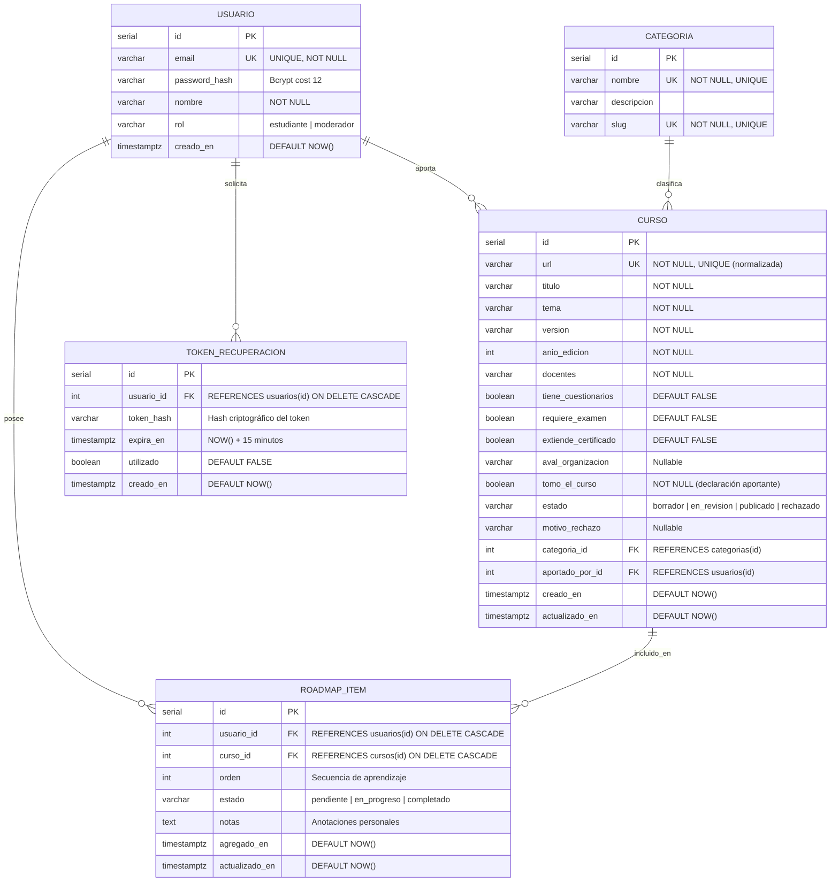
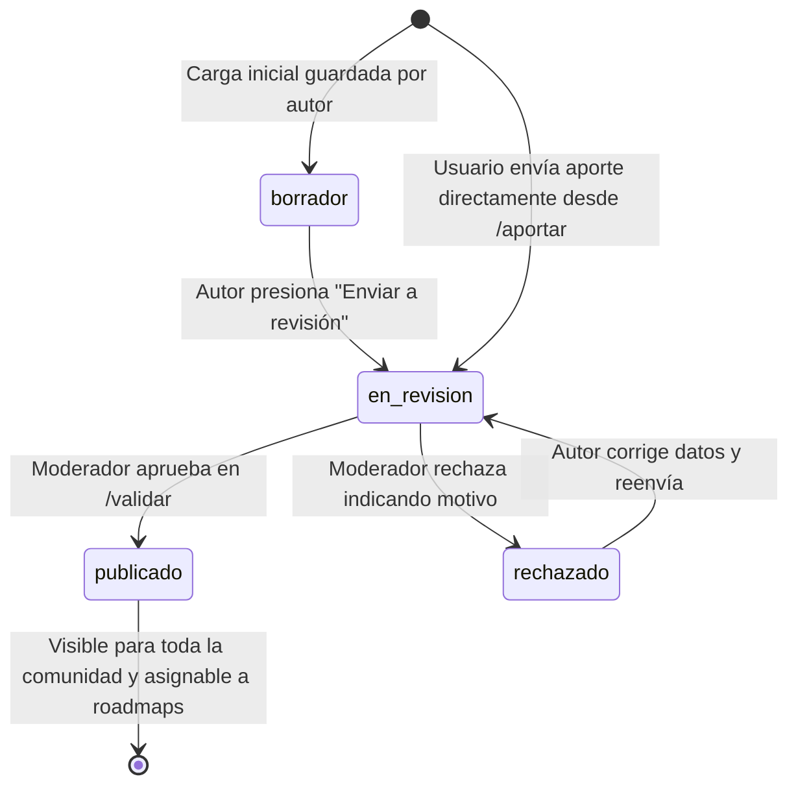

# BackendSchema — Modelo de Datos y Especificación de APIs REST — OpenRoadmap

> **Qué es este documento:** Establece el contrato formal del backend de **OpenRoadmap**: el modelo entidad-relación en **PostgreSQL 18.6**, especificación de tablas con constraints e índices, máquina de estados para el ciclo de vida de los cursos y el catálogo exhaustivo de endpoints de la API REST `/api/v1`.
> **Coherencia estricta:** Todo endpoint expuesto en este esquema atiende a una ruta y flujo especificados en `APPFlow.md` y cumple con los requisitos funcionales de `PRD.md`.

---

## 1. Modelo de Datos Relacional

### 1.1 Diagrama Entidad-Relación (Mermaid)



---

### 1.2 Especificación Detallada de Tablas

#### Tabla: `usuarios`
Almacena las credenciales y perfiles de los miembros de la comunidad.

| Columna | Tipo PostgreSQL | Modificadores / Constraints | Descripción |
|---------|-----------------|-----------------------------|-------------|
| `id` | `SERIAL` | `PRIMARY KEY` | Identificador único autoincremental. |
| `email` | `VARCHAR(255)` | `UNIQUE NOT NULL` | Correo electrónico en minúsculas (identificador de login). |
| `password_hash` | `VARCHAR(255)` | `NOT NULL` | Hash seguro generado con algoritmo **bcrypt** (factor de costo 12). |
| `nombre` | `VARCHAR(120)` | `NOT NULL` | Nombre y apellido del usuario. |
| `rol` | `VARCHAR(20)` | `NOT NULL DEFAULT 'estudiante'` | Rol del usuario (`estudiante`, `moderador`). |
| `creado_en` | `TIMESTAMPTZ` | `NOT NULL DEFAULT CURRENT_TIMESTAMP` | Fecha y hora UTC de registro. |

- **Índices:** `CREATE UNIQUE INDEX idx_usuarios_email ON usuarios(LOWER(email));`

---

#### Tabla: `categorias`
Lista cerrada de categorías y áreas de especialización tecnológica para el catálogo.

| Columna | Tipo PostgreSQL | Modificadores / Constraints | Descripción |
|---------|-----------------|-----------------------------|-------------|
| `id` | `SERIAL` | `PRIMARY KEY` | Identificador único de categoría. |
| `nombre` | `VARCHAR(80)` | `UNIQUE NOT NULL` | Nombre legible (ej: *Desarrollo Web*, *Backend*, *DevOps*, *Bases de Datos*). |
| `slug` | `VARCHAR(80)` | `UNIQUE NOT NULL` | Identificador URL-friendly (ej: *desarrollo-web*, *backend*). |
| `descripcion` | `VARCHAR(255)` | `NULL` | Breve alcance de la categoría. |

---

#### Tabla: `cursos`
Almacena el catálogo de cursos gratuitos con sus metadatos formativos y estado de moderación.

| Columna | Tipo PostgreSQL | Modificadores / Constraints | Descripción |
|---------|-----------------|-----------------------------|-------------|
| `id` | `SERIAL` | `PRIMARY KEY` | Identificador único del curso. |
| `url` | `VARCHAR(2048)` | `UNIQUE NOT NULL` | Enlace web activo normalizado (sin trailing slash ni UTMs). |
| `titulo` | `VARCHAR(200)` | `NOT NULL` | Título formal del curso. |
| `tema` | `VARCHAR(200)` | `NOT NULL` | Tema o tecnología central (ej: *FastAPI*, *React 19*, *Docker Compose*). |
| `version` | `VARCHAR(50)` | `NOT NULL` | Versión del software o curso (ej: *v2.0*, *Edición 2026*). |
| `anio_edicion` | `INTEGER` | `NOT NULL CHECK (anio_edicion >= 2000)` | Año de publicación o dictado del curso. |
| `docentes` | `VARCHAR(255)` | `NOT NULL` | Nombres de los instructores o disertantes. |
| `tiene_cuestionarios` | `BOOLEAN` | `NOT NULL DEFAULT FALSE` | Flag de cuestionarios interactivos. |
| `requiere_examen` | `BOOLEAN` | `NOT NULL DEFAULT FALSE` | Flag de requisito de examen final. |
| `extiende_certificado`| `BOOLEAN` | `NOT NULL DEFAULT FALSE` | Flag de emisión de certificado por la plataforma emisora. |
| `aval_organizacion` | `VARCHAR(150)` | `NULL` | Entidad académica o empresa que avala (ej: *UTN*, *Google*, *FreeCodeCamp*). |
| `tomo_el_curso` | `BOOLEAN` | `NOT NULL` | **Declaración obligatoria del aportante** indicando si cursó el contenido. |
| `estado` | `VARCHAR(20)` | `NOT NULL DEFAULT 'en_revision'` | Estado de ciclo de vida (`borrador`, `en_revision`, `publicado`, `rechazado`). |
| `motivo_rechazo` | `VARCHAR(500)` | `NULL` | Feedback del moderador en caso de no aprobación. |
| `categoria_id` | `INTEGER` | `NOT NULL REFERENCES categorias(id)` | Vínculo foráneo a la categoría correspondiente. |
| `aportado_por_id` | `INTEGER` | `NOT NULL REFERENCES usuarios(id)` | Usuario que aportó el recurso. |
| `creado_en` | `TIMESTAMPTZ` | `NOT NULL DEFAULT CURRENT_TIMESTAMP` | Fecha y hora UTC del aporte. |
| `actualizado_en` | `TIMESTAMPTZ` | `NOT NULL DEFAULT CURRENT_TIMESTAMP` | Fecha de última modificación o cambio de estado. |

- **Índices:**
  - `CREATE INDEX idx_cursos_estado_categoria ON cursos(estado, categoria_id);` (Acelera el filtrado en el catálogo público).
  - `CREATE INDEX idx_cursos_busqueda ON cursos USING GIN (to_tsvector('spanish', titulo || ' ' || tema || ' ' || docentes));` (Búsqueda full-text eficiente).

---

#### Tabla: `roadmap_items`
Tabla relacional que materializa el roadmap personal de cada usuario estudiante.

| Columna | Tipo PostgreSQL | Modificadores / Constraints | Descripción |
|---------|-----------------|-----------------------------|-------------|
| `id` | `SERIAL` | `PRIMARY KEY` | Identificador único del ítem de roadmap. |
| `usuario_id` | `INTEGER` | `NOT NULL REFERENCES usuarios(id) ON DELETE CASCADE` | Dueño del roadmap personal. |
| `curso_id` | `INTEGER` | `NOT NULL REFERENCES cursos(id) ON DELETE CASCADE` | Curso asignado a la ruta. |
| `orden` | `INTEGER` | `NOT NULL DEFAULT 1` | Posición secuencial del curso en el plan de aprendizaje. |
| `estado` | `VARCHAR(20)` | `NOT NULL DEFAULT 'pendiente'` | Progreso del usuario (`pendiente`, `en_progreso`, `completado`). |
| `notas` | `TEXT` | `NULL` | Apuntes personales del estudiante sobre el curso. |
| `agregado_en` | `TIMESTAMPTZ` | `NOT NULL DEFAULT CURRENT_TIMESTAMP` | Fecha de inclusión en el roadmap. |
| `actualizado_en` | `TIMESTAMPTZ` | `NOT NULL DEFAULT CURRENT_TIMESTAMP` | Fecha de actualización de estado. |

- **Constraints e Índices:**
  - `CONSTRAINT uq_usuario_curso UNIQUE (usuario_id, curso_id)` (Impide agregar dos veces el mismo curso).
  - `CREATE INDEX idx_roadmap_usuario_orden ON roadmap_items(usuario_id, orden);` (Optimiza el listado secuencial de cursos).

---

#### Tabla: `tokens_recuperacion`
Gestión de tokens seguros de un solo uso para restablecimiento de contraseñas.

| Columna | Tipo PostgreSQL | Modificadores / Constraints | Descripción |
|---------|-----------------|-----------------------------|-------------|
| `id` | `SERIAL` | `PRIMARY KEY` | Identificador único. |
| `usuario_id` | `INTEGER` | `NOT NULL REFERENCES usuarios(id) ON DELETE CASCADE` | Usuario solicitante. |
| `token_hash` | `VARCHAR(255)` | `NOT NULL` | Hash criptográfico (SHA-256) del token temporal emitido. |
| `expira_en` | `TIMESTAMPTZ` | `NOT NULL` | Timestamp límite de validez (creación + 15 minutos). |
| `utilizado` | `BOOLEAN` | `NOT NULL DEFAULT FALSE` | Flag de uso para garantizar un solo consumo. |
| `creado_en` | `TIMESTAMPTZ` | `NOT NULL DEFAULT CURRENT_TIMESTAMP` | Fecha de emisión. |

- **Índices:** `CREATE INDEX idx_tokens_hash_valido ON tokens_recuperacion(token_hash, utilizado, expira_en);`

---

## 2. Máquina de Estados del Ciclo de Vida del Curso



| Estado | Visibilidad | Acciones Habilitadas |
|--------|-------------|----------------------|
| `borrador` | Exclusivo del usuario autor. | Editar campos, eliminar, enviar a revisión. |
| `en_revision` | Autor y usuarios con rol `moderador`. | Moderador audita link y metadatos; puede Aprobar o Rechazar. |
| `publicado` | **Público y visible para toda la comunidad.** | Cualquier usuario puede agregarlo a su roadmap; disponible en búsquedas y filtros. |
| `rechazado` | Autor y usuarios con rol `moderador`. | Autor visualiza el motivo de rechazo; moderador puede reabrirlo si hubo error. |

---

## 3. Especificación de la API REST (`/api/v1`)

### Convenciones Generales
- **Base Path:** `/api/v1`
- **Paginación Uniforme:** `?page=1&page_size=12`
  - Respuesta estándar:
    ```json
    {
      "items": [ ... ],
      "total": 48,
      "page": 1,
      "page_size": 12,
      "total_pages": 4
    }
    ```
- **Formato de Errores:** RFC 7807 (`application/problem+json`).
- **Autenticación:** Header HTTP `Authorization: Bearer <jwt_token>`.

---

### 3.1 Módulo: Identidad y Autenticación (`/api/v1/auth`)

| Método | Endpoint | Acceso | Request Body | Códigos de Respuesta |
|--------|----------|--------|--------------|----------------------|
| `POST` | `/api/v1/auth/registro` | Público | `{ "email": "str", "password": "str", "nombre": "str" }` | `201 Created`<br>`409 Conflict` (email duplicado)<br>`422 Unprocessable Entity` |
| `POST` | `/api/v1/auth/login` | Público (Rate limited: 5 req/min) | `{ "email": "str", "password": "str" }` | `200 OK` `{ "access_token": "...", "token_type": "bearer", "usuario": { ... } }`<br>`401 Unauthorized`<br>`429 Too Many Requests` |
| `GET` | `/api/v1/auth/me` | Autenticado | — | `200 OK` `{ "id": 1, "email": "...", "nombre": "...", "rol": "..." }`<br>`401 Unauthorized` |
| `POST` | `/api/v1/auth/solicitar-recuperacion` | Público | `{ "email": "str" }` | `200 OK` `{ "message": "Si el email está registrado, se generó el token de recuperación." }` |
| `POST` | `/api/v1/auth/restablecer-password` | Público | `{ "token": "str", "nueva_password": "str" }` | `200 OK` `{ "message": "Contraseña actualizada exitosamente." }`<br>`400 Bad Request` (token inválido o expirado) |

---

### 3.2 Módulo: Catálogo de Cursos (`/api/v1/cursos`)

| Método | Endpoint | Acceso | Query Params | Respuestas |
|--------|----------|--------|--------------|------------|
| `GET` | `/api/v1/cursos` | Público | `page=1`<br>`page_size=12`<br>`categoria_id=int`<br>`q=str`<br>`certificado=bool`<br>`examen=bool`<br>`cuestionarios=bool` | `200 OK` (Objeto paginado de cursos en estado `publicado`)<br>`422 Unprocessable Entity` |
| `GET` | `/api/v1/cursos/{id}` | Público | — | `200 OK` (Detalle de curso con metadatos completos y categoría)<br>`404 Not Found` |

Ejemplo de respuesta `GET /api/v1/cursos?page=1&page_size=1`:
```json
{
  "items": [
    {
      "id": 1,
      "titulo": "FastAPI de Cero a Producción",
      "tema": "Desarrollo de APIs REST asíncronas",
      "version": "v0.115",
      "anio_edicion": 2026,
      "docentes": "Ing. Carlos Mendoza",
      "tiene_cuestionarios": true,
      "requiere_examen": false,
      "extiende_certificado": true,
      "aval_organizacion": "Comunidad Python Argentina",
      "tomo_el_curso": true,
      "estado": "publicado",
      "url": "https://www.youtube.com/playlist?list=PLxyz123",
      "categoria": {
        "id": 2,
        "nombre": "Backend",
        "slug": "backend"
      },
      "creado_en": "2026-10-21T18:30:00Z"
    }
  ],
  "total": 35,
  "page": 1,
  "page_size": 1,
  "total_pages": 35
}
```

---

### 3.3 Módulo: Aportes de Cursos y Moderación (`/api/v1/aportes`)

| Método | Endpoint | Acceso Requerido | Request Body | Respuestas |
|--------|----------|------------------|--------------|------------|
| `POST` | `/api/v1/aportes` | Autenticado (`estudiante`, `moderador`) | `{ "url": "str", "titulo": "str", "tema": "str", "version": "str", "anio_edicion": int, "docentes": "str", "tiene_cuestionarios": bool, "requiere_examen": bool, "extiende_certificado": bool, "aval_organizacion": "str", "tomo_el_curso": bool, "categoria_id": int }` | `201 Created` (Curso en estado `en_revision`)<br>`409 Conflict` (URL ya registrada)<br>`422 Unprocessable Entity` |
| `GET` | `/api/v1/aportes/cola` | Solo `moderador` | `page=1`, `page_size=20` | `200 OK` (Listado paginado de cursos en estado `en_revision`)<br>`403 Forbidden` |
| `POST` | `/api/v1/aportes/{id}/validar` | Solo `moderador` | `{ "aprobado": true, "motivo_rechazo": null }` o `{ "aprobado": false, "motivo_rechazo": "Enlace caído" }` | `200 OK` (Curso actualizado a `publicado` o `rechazado`)<br>`403 Forbidden`<br>`404 Not Found` |

---

### 3.4 Módulo: Roadmap Personal (`/api/v1/roadmap`)

| Método | Endpoint | Acceso | Request / Query | Respuestas |
|--------|----------|--------|-----------------|------------|
| `GET` | `/api/v1/roadmap` | Autenticado | `page=1`, `page_size=50` | `200 OK` (Listado ordenado por columna `orden` con los datos del curso incluido)<br>`401 Unauthorized` |
| `POST` | `/api/v1/roadmap/items` | Autenticado | `{ "curso_id": 1 }` | `201 Created` (Ítem agregado en estado `pendiente` con el siguiente número de orden)<br>`404 Not Found` (curso no existe o no publicado)<br>`409 Conflict` (curso ya agregado) |
| `PATCH`| `/api/v1/roadmap/items/{id}`| Autenticado | `{ "estado": "en_progreso", "orden": 2, "notas": "Terminar módulo 3" }` | `200 OK`<br>`404 Not Found`<br>`422 Unprocessable Entity` |
| `DELETE`|`/api/v1/roadmap/items/{id}`| Autenticado | — | `204 No Content`<br>`404 Not Found` |

---

### 3.5 Módulo: Categorías (`/api/v1/categorias`)

| Método | Endpoint | Acceso | Parámetros | Respuestas |
|--------|----------|--------|------------|------------|
| `GET` | `/api/v1/categorias` | Público | — | `200 OK` (Colección completa de categorías activas para filtros y selects) |

---

## 4. Fundamentación de Decisiones del Esquema

1. **Categorías como tabla normalizada vs `ENUM` estático:** Se opta por tabla independiente `categorias` para permitir que los moderadores o administradores incorporen nuevas disciplinas formativas (ej: *Inteligencia Artificial*, *Ciberseguridad*) mediante migraciones de datos sin requerir alteraciones DDL bloqueantes en tipos ENUM de PostgreSQL.
2. **Tabla intermedia `roadmap_items` con atributos de dominio:** El roadmap no es un simple marcador (bookmark); modela el aprendizaje continuo del estudiante. Contener campos como `orden` (para secuenciar qué aprender primero) y `estado` (`pendiente`, `en_progreso`, `completado`) permite entregar valor formativo real y habilitar analíticas de progreso.
3. **Flags booleanos explícitos para auditoría:** Separar `tiene_cuestionarios`, `requiere_examen`, `extiende_certificado` y `tomo_el_curso` en columnas booleanas no nulas optimiza la indexación y permite realizar filtros facetados de alta velocidad en SQL, evitando el parsing ineficiente de documentos JSONB no estructurados.
4. **Normalización estricta de URLs con constraint UNIQUE:** Previo a la inserción en la base de datos, el backend aplica una normalización que remueve fragmentos (`#`), parámetros de tracking UTM (`utm_source`, etc.) y barras finales, asegurando que un mismo recurso educativo externo no pueda ser cargado repetidamente bajo diferentes variantes sintácticas.
