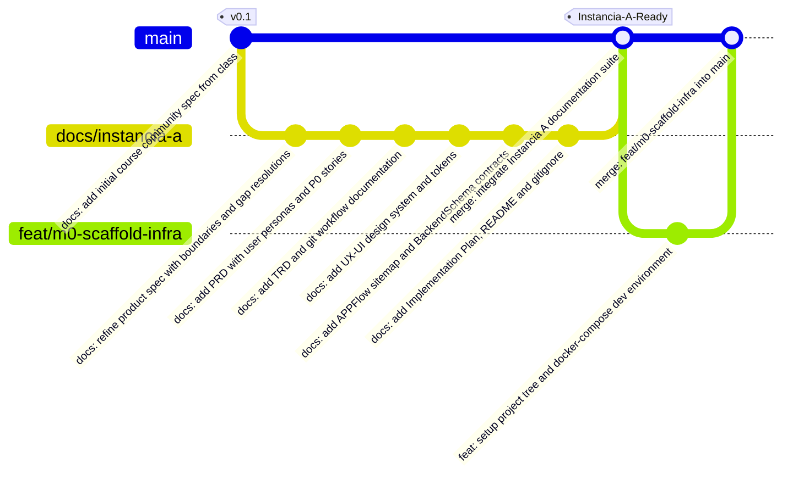

# Guía de Flujo de Trabajo en Git (Git Workflow) — OpenRoadmap

> **Objetivo:** Establecer la estrategia formal de branching, convenciones de commit, ciclo de vida de ramas y criterios de integración para el proyecto **OpenRoadmap**, asegurando un historial limpio, auditable y 100% conforme a las pautas de la cátedra de Desarrollo de Software.

---

## 1. Estrategia de Ramas Elegida: GitHub Flow

Se adopta una variante formal de **GitHub Flow** adaptada al ciclo académico de dos instancias:



### Reglas Fundamentales del Flujo
1. **Rama `main` protegida:** Representa el estado estable y entregable del proyecto. No se realiza ningún commit directo sobre `main` tras el commit fundacional de la SPEC.
2. **Ramas de corta duración:** Cada entrega o módulo se desarrolla en una rama dedicada originada a partir de `main`.
3. **Integración con Merge explícito (`--no-ff`):** Todos los merges hacia `main` se realizan con preservación de historial para que los puntos de bifurcación y unión sean claramente observables en `git log --graph`.

---

## 2. Nomenclatura de Ramas (Naming Conventions)

Toda rama creada debe respetar el siguiente prefijo según su naturaleza:

| Tipo de Trabajo | Prefijo / Patrón de Rama | Ejemplo Real |
|-----------------|--------------------------|--------------|
| **Documentación** | `docs/<tema-o-instancia>` | `docs/instancia-a` |
| **Nueva funcionalidad** | `feat/<modulo>-<nombre-descriptivo>` | `feat/m1-auth-jwt` |
| **Corrección de errores** | `fix/<descripcion-corta>` | `fix/login-rate-limit-timeout` |
| **Infraestructura / Docker** | `docker/<servicio>` | `docker/postgres-compose` |
| **Refactorización interna** | `refactor/<alcance>` | `refactor/course-repository-queries` |

---

## 3. Convención de Mensajes de Commit (Conventional Commits)

El 100% de los commits del repositorio debe estructurarse conforme a la especificación **Conventional Commits v1.0.0**:

```text
<tipo>(<alcance_opcional>): <descripción imperativa en minúsculas>

[cuerpo explicativo opcional: por qué se realizó el cambio]

[referencias o pie opcional: ej. Closes #12]
```

### Tipos Permitidos y Ejemplos Concretos

| Tipo | Propósito | Ejemplo Válido | Ejemplo Prohibido (Rechazado) |
|------|-----------|----------------|-------------------------------|
| `docs` | Modificaciones o altas en documentación y archivos `.md`. | `docs: add PRD user stories and acceptance criteria` | `docs: cambios`, `docs: wip` |
| `feat` | Implementación de una nueva característica o endpoint. | `feat(auth): implement bcrypt password hashing and jwt generation` | `feat: agregue cosas` |
| `fix` | Corrección de un defecto o bug. | `fix(catalogo): resolve pagination offset calculation bug` | `fix: arreglado` |
| `docker` | Configuración de Dockerfiles o Compose. | `docker: configure postgres 18.6 service and healthcheck` | `docker: update` |
| `test` | Incorporación o ajuste de tests unitarios o integración. | `test(aportes): add unit tests for url validation service` | `test: pruebas` |
| `refactor` | Cambio de código que no altera funcionalidad ni arregla bugs. | `refactor(roadmap): split controller logic into service layer` | `refactor: clean` |
| `chore` | Actualización de dependencias, configs o tooling. | `chore: update pnpm lockfile and eslint rules` | `chore: varios` |

---

## 4. Procedimiento de Integración Paso a Paso (Checklist para el Alumno)

Antes de integrar cualquier rama hacia `main`:
1. Asegurarse de que el directorio de trabajo esté limpio (`git status`).
2. Verificar que todos los commits utilicen Conventional Commits específicos.
3. Posicionarse en la rama `main`:
   ```bash
   git checkout main
   ```
4. Realizar el merge explícito sin fast-forward:
   ```bash
   git merge --no-ff docs/instancia-a -m "merge: integrate Instancia A documentation suite"
   ```
5. Comprobar la visualización gráfica del historial:
   ```bash
   git log --oneline --graph --all
   ```
6. Enviar los cambios al repositorio remoto en GitHub:
   ```bash
   git push origin main
   git push origin --all
   ```
