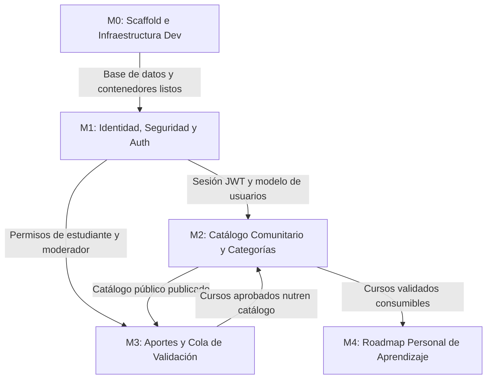

# Implementation Plan — Plan de Implementación y Ejecución — OpenRoadmap

> **Qué es este documento:** Establece el orden cronológico y modular de construcción técnica para la **Instancia B** de **OpenRoadmap**. Define la secuencia estricta de dependencias, el desglose granular de tareas con criterios de aceptación verificables (**Definition of Done**) y la estrategia formal de testing automatizado planificada para la clase del 27/10.
> **Definition of Done del Plan:** Cada tarea tiene un entregable observable mediante comandos o interacciones en la UI; el MVP P0 está delimitado sin ambigüedades; el grafo de dependencias impide cuellos de botella durante el desarrollo.

---

## 1. Definición del MVP (Alcance P0)

> **Criterio de Aceptación Global del MVP (Instancia B):**
> En una computadora limpia sin herramientas previas instaladas más allá de Docker y Git:
> ```bash
> git clone <repo-url>
> cd roadmap-cursos
> docker compose up --build
> ```
> 1. Los 3 contenedores (`postgres:18.6`, `backend:FastAPI` y `frontend:Vite`) levantan saludablemente y se interconectan sin intervención manual.
> 2. Se ejecutan end-to-end desde el navegador las **5 Historias de Usuario P0** del PRD sin errores en la consola:
>    - **US-001 (Catálogo Comunitario):** Se visualiza la grilla de cursos seed paginada, con filtros por categoría y búsqueda funcionando.
>    - **US-002 (Aporte de Cursos):** Un usuario registrado aporta un nuevo curso completando todos los metadatos y declarando si lo tomó; el curso queda registrado en estado `en_revision`.
>    - **US-003 (Roadmap Personal):** El usuario agrega un curso del catálogo a su roadmap personal, actualiza su estado a `en_progreso` y reordena sus prioridades.
>    - **US-004 (Autenticación y Seguridad):** Registro de usuario, login con generación de token JWT, bloqueo de IP tras 5 intentos fallidos (rate limit) y simulación del ciclo de recuperación de contraseña vía token temporal.
>    - **US-005 (Moderación y Validación):** Un usuario con rol `moderador` accede a `/validar`, audita el aporte pendiente y lo aprueba, haciéndolo visible de inmediato en el catálogo público general.

---

## 2. Grafo de Módulos y Dependencias Técnicas



---

## 3. Desglose Detallado de Tareas por Módulo

### Módulo M0 — Scaffold e Infraestructura Dev
| # | Tarea | Hecho Cuando (Definition of Done) | Estimación |
|---|-------|-----------------------------------|------------|
| **0.1** | Creación del árbol de carpetas con **Screaming Architecture** (TRD §3.2). | La estructura de directorios en `backend/` y `frontend/` existe en el repo, limpia y estructurada por dominio. | 30 min |
| **0.2** | Configuración de `docker-compose.yml` con servicio `postgres:18.6-alpine`. | `docker compose up postgres` levanta y responde conexiones en puerto 5432 con volumen persistente. | 45 min |
| **0.3** | Inicialización de backend FastAPI con `uv`, settings Pydantic y healthcheck. | `curl -f http://localhost:8000/health` responde HTTP 200 con `{"status": "ok", "db": "connected"}`. | 1 h |
| **0.4** | Inicialización de frontend React 19 + Vite + pnpm con shell básico y tokens CSS. | `http://localhost:5173` renderiza el layout principal con Header (menú sándwich) y tokens de `tokens.css`. | 1 h |

---

### Módulo M1 — Identidad, Seguridad y Autenticación
| # | Tarea | Hecho Cuando (Definition of Done) | Estimación |
|---|-------|-----------------------------------|------------|
| **1.1** | Modelo SQLAlchemy `usuarios` y migración inicial con Alembic. | Tabla `usuarios` creada en PostgreSQL con índice único sobre email en minúsculas. | 45 min |
| **1.2** | Servicios de criptografía (hashing bcrypt costo 12 y firma de JWTs). | Módulo `security.py` genera hashes no reversibles y valida contraseñas y tokens firmados. | 45 min |
| **1.3** | Endpoints de `registro`, `login` con rate limiting (slowapi 5 req/min) y `/me`. | `POST /api/v1/auth/login` devuelve token JWT; el 6to intento consecutivo en <1 min responde HTTP 429. | 1.5 h |
| **1.4** | Flujo de recuperación de contraseña por token temporal de 15 minutos. | `POST /api/v1/auth/solicitar-recuperacion` emite token en log; `restablecer-password` actualiza la clave. | 1.5 h |
| **1.5** | Pantallas de UI: `/login`, `/registro` y `/recuperar-password`. | Formularios funcionales con validación inline, manejo de errores accesibles y guardado de sesión en frontend. | 2 h |

---

### Módulo M2 — Catálogo Comunitario y Categorías
| # | Tarea | Hecho Cuando (Definition of Done) | Estimación |
|---|-------|-----------------------------------|------------|
| **2.1** | Modelos `categorias` y `cursos` con migración y script de seed inicial. | Base cargada con 6 categorías técnicas y al menos 15 cursos reales gratuitos con metadatos completos. | 1 h |
| **2.2** | Endpoint `GET /api/v1/cursos` con paginación obligatoria y filtros facetados. | Consulta paginada (`page`, `page_size`) responde contrato estándar y filtra por categoría, tema y flags. | 1.5 h |
| **2.3** | Componente de UI: `CourseCard`, grilla responsive mobile-first y paginador. | Pantalla `/catalogo` renderiza tarjetas con badges; paginador funcional; vista a 1 col en mobile y 3 en desktop. | 2 h |
| **2.4** | Pantalla de Detalle de Curso (`/catalogo/:id`). | Vista profunda con metadatos completos de auditoría, enlace externo activo y botón de acción. | 1 h |

---

### Módulo M3 — Aportes de Cursos y Cola de Validación
| # | Tarea | Hecho Cuando (Definition of Done) | Estimación |
|---|-------|-----------------------------------|------------|
| **3.1** | Servicio de aporte con normalización de URL y control de unicidad. | `POST /api/v1/aportes` valida campos obligatorios, persiste con estado `en_revision` y bloquea duplicados. | 1.5 h |
| **3.2** | Formulario frontend de aporte (`/aportar`) con checkbox de toma de curso. | Formulario accesible con validación en tiempo real y selector de categoría alimentado de API. | 2 h |
| **3.3** | Cola de moderación en backend con restricción estricta de rol `moderador`. | `GET /api/v1/aportes/cola` y `POST /api/v1/aportes/{id}/validar` responden 403 a usuarios con rol estudiante. | 1.5 h |
| **3.4** | Pantalla `/validar` para moderadores con acciones de Aprobar y Rechazar. | El moderador audita el aporte, hace clic en Aprobar y el curso pasa instantáneamente al catálogo público. | 1.5 h |

---

### Módulo M4 — Roadmap Personal de Aprendizaje
| # | Tarea | Hecho Cuando (Definition of Done) | Estimación |
|---|-------|-----------------------------------|------------|
| **4.1** | Modelo relacional `roadmap_items` con constraint único `(usuario_id, curso_id)`. | Tabla creada en PostgreSQL con claves foráneas, índices de orden y cascada de borrado. | 45 min |
| **4.2** | Endpoints de Roadmap (`GET`, `POST`, `PATCH`, `DELETE`). | CRUD completo para agregar cursos, actualizar estado (`pendiente`/`en_progreso`/`completado`) y ordenar. | 2 h |
| **4.3** | Pantalla de UI `/roadmap` con indicador porcentual de avance. | El estudiante visualiza su ruta formativa, actualiza el estado de cada curso y reordena sus prioridades. | 2 h |
| **4.4** | Integración del botón *"Agregar a mi Roadmap"* en las tarjetas del catálogo. | Al presionar el botón en `/catalogo`, el ítem se asocia al usuario y el botón pasa a estado *"En tu Roadmap ✓"*. | 1 h |

---

## 4. Tabla de Seguimiento de Ejecución (Instancia B)

> Esta tabla se mantendrá actualizada durante el desarrollo de la Instancia B vinculando cada tarea a su rama correspondiente según el **Git Workflow**.

| # | Módulo | Tarea Resumida | Estado | Rama de Git | Commit SHA Asociado |
|---|--------|----------------|--------|-------------|---------------------|
| 0.1 | M0 | Árbol Screaming Architecture | `[ ]` | `feat/m0-scaffold` | — |
| 0.2 | M0 | Docker Compose Postgres 18.6 | `[ ]` | `feat/m0-scaffold` | — |
| 0.3 | M0 | FastAPI base con healthcheck | `[ ]` | `feat/m0-scaffold` | — |
| 0.4 | M0 | Vite React 19 shell y tokens | `[ ]` | `feat/m0-scaffold` | — |
| 1.1 | M1 | Modelo de usuarios y Alembic | `[ ]` | `feat/m1-auth` | — |
| 1.2 | M1 | Hashing Bcrypt y JWT | `[ ]` | `feat/m1-auth` | — |
| 1.3 | M1 | Login, registro y rate limit | `[ ]` | `feat/m1-auth` | — |
| 1.4 | M1 | Flujo recuperación contraseña | `[ ]` | `feat/m1-auth` | — |
| 1.5 | M1 | UI pantallas de autenticación | `[ ]` | `feat/m1-auth` | — |
| 2.1 | M2 | Seed de categorías y cursos | `[ ]` | `feat/m2-catalogo` | — |
| 2.2 | M2 | API catálogo paginado + filtros| `[ ]` | `feat/m2-catalogo` | — |
| 2.3 | M2 | UI Catálogo mobile-first | `[ ]` | `feat/m2-catalogo` | — |
| 2.4 | M2 | UI Detalle de curso | `[ ]` | `feat/m2-catalogo` | — |
| 3.1 | M3 | Backend servicio de aportes | `[ ]` | `feat/m3-aportes` | — |
| 3.2 | M3 | UI Formulario de aporte | `[ ]` | `feat/m3-aportes` | — |
| 3.3 | M3 | API Moderación rol moderador | `[ ]` | `feat/m3-aportes` | — |
| 3.4 | M3 | UI Pantalla `/validar` | `[ ]` | `feat/m3-aportes` | — |
| 4.1 | M4 | Modelo `roadmap_items` | `[ ]` | `feat/m4-roadmap` | — |
| 4.2 | M4 | Endpoints CRUD roadmap | `[ ]` | `feat/m4-roadmap` | — |
| 4.3 | M4 | UI Pantalla `/roadmap` | `[ ]` | `feat/m4-roadmap` | — |
| 4.4 | M4 | Integración catálogo-roadmap | `[ ]` | `feat/m4-roadmap` | — |

---

## 5. Estrategia de Testing (Planificada para la Clase del 27/10)

En estricta conformidad con el cronograma de la práctica, la implementación de tests automatizados se abordará formalmente en la clase presencial del 27/10 sobre la base de código desarrollada y aprobada. No obstante, la arquitectura diseñada en el TRD ya contempla los patrones necesarios para su instrumentación directa:

### 5.1 Testing Unitario de Lógica de Negocio Pura (Services)
- **Alcance:** Capa `service.py` en backend (validación de aportes, cálculo secuencial de orden en roadmap, reglas de unicidad y normalización de URLs, transiciones de estado de cursos).
- **Enfoque:** Patrón **AAA (Arrange, Act, Assert)** con funciones aisladas; cero llamadas a base de datos y cero dependencias de FastAPI/HTTP.
- **Framework:** `pytest` con `pytest-mock`.
- **Meta de cobertura:** ≥ 85% en las capas de servicio.

### 5.2 Testing de Integración de Persistencia y Endpoints
- **Alcance:** Verificación de repositorios contra una base de datos PostgreSQL real levantada en el entorno Docker dev.
- **Enfoque:** `httpx.AsyncClient` ejecutando peticiones reales contra los routers de FastAPI, testeando transacciones, constraints de unicidad y control de acceso por roles.

### 5.3 Testing de Frontend
- **Alcance:** Hooks personalizados (`useCourses`, `useRoadmap`, `useAuth`) y componentes críticos de UI (`PaginationBar`, `CourseCard`, `Navbar`).
- **Framework:** `Vitest` + `React Testing Library`.

---

## 6. Matriz de Riesgos del Plan de Implementación

| Riesgo Identificado | Impacto | Probabilidad | Estrategia Preventiva de Mitigación |
|---------------------|---------|--------------|-------------------------------------|
| **Complejidad del formulario de aporte (12 campos)** | Alto | Media | Utilización de un schema Pydantic unificado y validación declarativa con React Hook Form en frontend para evitar validaciones manuales dispersas. |
| **Tiempo de armado del seed de datos de prueba** | Medio | Baja | Creación de un script Python reutilizable (`seed.py`) con datos JSON estáticos bien estructurados para poblar la base en segundos. |
| **Divergencia de dependencias de node o python** | Alto | Baja | Ejecución estricta dentro de los contenedores Docker mediante `pnpm` (lockfile congelado) y `uv` con lockfile determinista. |
