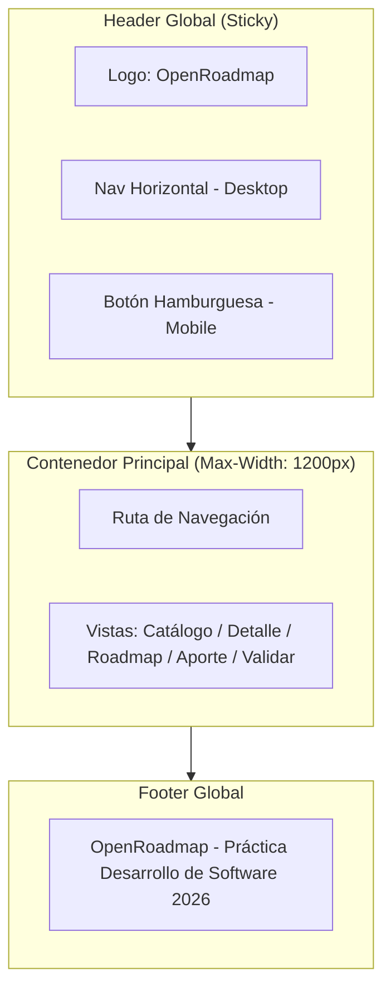

# UX-UI — Guía Visual de Estilos y Sistema de Diseño — OpenRoadmap

> **Qué es este documento:** Define la gramática visual formal de la interfaz de **OpenRoadmap**: tokens de diseño, tipografía, componentes reutilizables con todos sus estados interactivos, directrices de accesibilidad WCAG 2.1 AA y la estrategia técnica estricta de **Mobile-First con Mejora Progresiva**.
> **Inspiración:** Estética limpia y funcional inspirada en **Google y Material Design 3** (predominio del espacio en blanco, jerarquía tipográfica sin estridencias, Google Blue `#1a73e8` como color primario de acción, radios suaves y elevaciones sutiles).
> **Definition of Done de UX-UI:** Dos desarrolladores frontend independientes que sigan esta guía maquetan la misma pantalla y obtienen un resultado visual y funcionalmente idéntico; ningún componente interactivo carece de sus estados de foco o error.

---

## 1. Principios de Diseño

1. **Claridad sobre adorno:** Cada elemento en pantalla debe comunicar información o habilitar una acción concreta. Se elimina cualquier elemento visual accesorio que distraiga del contenido educativo.
2. **Espacio en blanco como agrupador visual:** El aire y el ritmo vertical agrupan los contenidos de forma más limpia y descansada que el abuso de bordes gruesos o cajas anidadas.
3. **Un único color de acción principal por vista:** El azul de Google (`#1a73e8`) guía la atención del usuario hacia la acción principal (CTA primario), reduciendo la carga cognitiva.
4. **Mobile-First real con mejora progresiva:** La maquetación base se diseña y prueba para pantallas móviles (360px) en una sola columna con controles táctiles amplios, y se amplía hacia resoluciones superiores únicamente para añadir riqueza espacial, nunca para remendar el diseño base.
5. **Estados de carga, vacío y error como ciudadanos de primera clase:** No existen pantallas "en blanco"; cada vista prevé explícitamente qué mostrar mientras se esperan datos (`skeleton`), qué hacer si no hay registros (`empty state`) y cómo recuperarse ante fallos (`error state`).

---

## 2. Design Tokens

### 2.1 Paleta de Colores (Inspirada en Google / Material 3)

| Token CSS | Valor Hex / HSL | Rol y Caso de Uso | Contraste WCAG AA (Normal Text) |
|-----------|-----------------|-------------------|----------------------------------|
| `--color-primary` | `#1a73e8` | Acciones principales, links activos, foco interactivo | 4.6:1 vs blanco (`#ffffff`) ✓ AA |
| `--color-primary-hover` | `#185abc` | Estado hover y active de botones primarios | 6.5:1 vs blanco (`#ffffff`) ✓ AAA |
| `--color-primary-container`| `#e8f0fe` | Fondos de chips seleccionados, tabs activas, badges suaves | 12.8:1 vs `--color-primary` ✓ AA |
| `--color-on-primary` | `#ffffff` | Texto e iconos sobre superficies primarias | 4.6:1 vs `#1a73e8` ✓ AA |
| `--color-surface` | `#ffffff` | Superficie de tarjetas (cards), modales y encabezado | Base neutra |
| `--color-background` | `#f8f9fa` | Fondo global de la aplicación (gris claro Google) | Base neutra |
| `--color-text` | `#202124` | Texto principal, títulos y encabezados | 15.8:1 vs `#ffffff` ✓ AAA |
| `--color-text-muted` | `#5f6368` | Metadatos secundarios, subtítulos, placeholders | 7.0:1 vs `#ffffff` ✓ AAA |
| `--color-border` | `#dadce0` | Bordes de inputs, divisores sutiles de lista | 3.2:1 vs fondo (UI components) ✓ |
| `--color-hover-subtle` | `#f1f3f4` | Hover sobre filas de tabla, tarjetas y botones secundarios | Fondo neutro interactivo |
| `--color-success` | `#188038` | Badges de curso publicado, toast de confirmación | 4.7:1 vs blanco ✓ AA |
| `--color-warning` | `#e37400` | Badge de aporte en revisión, alertas preventivas | 4.5:1 vs blanco ✓ AA |
| `--color-error` | `#d93025` | Mensajes de error en formularios, estados de fallo | 4.6:1 vs blanco ✓ AA |

*Todos los ratios de contraste fueron verificados conforme a los estándares de la Web Accessibility Initiative (W3C).*

---

### 2.2 Tipografía

Se adopta **Roboto** (fuente emblemática de Google Material Design) complementada con fuentes del sistema para optimizar el First Contentful Paint:

| Token CSS | Fuente / Familia | Tamaño / Line-Height | Peso | Uso Específico |
|-----------|------------------|----------------------|------|----------------|
| `--font-base` | `'Roboto', -apple-system, BlinkMacSystemFont, 'Segoe UI', sans-serif` | — | 400 | Familia tipográfica global |
| `--text-xs` | `--font-base` | `12px` / `16px` | 500 | Badges, tags de estado, notas al pie |
| `--text-sm` | `--font-base` | `14px` / `20px` | 400 | Metadatos de curso, textos de ayuda en inputs |
| `--text-base` | `--font-base` | `16px` / `24px` | 400 | Cuerpo de texto, campos de formulario, botones |
| `--text-lg` | `--font-base` | `18px` / `24px` | 500 | Títulos de tarjetas de curso, subtítulos de sección |
| `--text-xl` | `--font-base` | `22px` / `28px` | 700 | Títulos de páginas principales, nombres de sección |
| `--text-2xl` | `--font-base` | `28px` / `34px` | 700 | Encabezados de bienvenida y hero |

---

### 2.3 Espaciado, Radios, Sombras y Capas

| Categoría | Token CSS | Valor | Uso en Componentes |
|-----------|-----------|-------|--------------------|
| **Espaciado** | `--space-1` | `4px` | Separación mínima entre icono y texto |
| | `--space-2` | `8px` | Padding interno de badges y botones pequeños |
| | `--space-3` | `12px` | Gaps en formularios y espaciado compacto |
| | `--space-4` | `16px` | Padding de tarjetas, gutters base en mobile |
| | `--space-6` | `24px` | Separación entre secciones y padding de modales |
| | `--space-8` | `32px` | Márgenes verticales entre bloques de contenido |
| | `--space-12` | `48px` | Separaciones de página en desktop |
| **Bordes** | `--radius-sm` | `4px` | Badges, tags compactos |
| | `--radius-md` | `8px` | Inputs, selects, botones rectangulares |
| | `--radius-lg` | `16px` | Tarjetas de curso, paneles modales |
| | `--radius-full` | `9999px` | Botones de píldora (Pill buttons estilo Material 3) |
| **Sombras** | `--shadow-1` | `0 1px 2px 0 rgba(60,64,67,0.3), 0 1px 3px 1px rgba(60,64,67,0.15)` | Elevación base de cards en reposo |
| | `--shadow-2` | `0 1px 3px 0 rgba(60,64,67,0.3), 0 4px 8px 3px rgba(60,64,67,0.15)` | Hover en cards, dropdowns, menús |
| | `--shadow-3` | `0 4px 12px 0 rgba(60,64,67,0.2), 0 8px 24px 4px rgba(60,64,67,0.15)` | Modales y diálogos flotantes |
| **Z-Index** | `--z-base` | `1` | Contenido base |
| | `--z-sticky` | `100` | Header y navegación pegajosa superior |
| | `--z-drawer` | `200` | Panel sándwich de navegación móvil |
| | `--z-modal` | `300` | Fondo y ventana de diálogo modal |
| | `--z-toast` | `400` | Notificaciones flotantes tipo toast |

---

### 2.4 Bloque de Variables CSS para Copiar (`tokens.css`)

```css
:root {
  /* Paleta de Colores Google Material 3 */
  --color-primary: #1a73e8;
  --color-primary-hover: #185abc;
  --color-primary-container: #e8f0fe;
  --color-on-primary: #ffffff;
  --color-surface: #ffffff;
  --color-background: #f8f9fa;
  --color-text: #202124;
  --color-text-muted: #5f6368;
  --color-border: #dadce0;
  --color-hover-subtle: #f1f3f4;
  --color-success: #188038;
  --color-warning: #e37400;
  --color-error: #d93025;

  /* Tipografía */
  --font-base: 'Roboto', -apple-system, BlinkMacSystemFont, 'Segoe UI', sans-serif;
  --text-xs: 12px;
  --text-sm: 14px;
  --text-base: 16px;
  --text-lg: 18px;
  --text-xl: 22px;
  --text-2xl: 28px;

  /* Espaciado (Escala 4px/8px) */
  --space-1: 4px;
  --space-2: 8px;
  --space-3: 12px;
  --space-4: 16px;
  --space-6: 24px;
  --space-8: 32px;
  --space-12: 48px;

  /* Bordes y Radios */
  --radius-sm: 4px;
  --radius-md: 8px;
  --radius-lg: 16px;
  --radius-full: 9999px;

  /* Sombras y Elevaciones */
  --shadow-1: 0 1px 2px 0 rgba(60,64,67,0.3), 0 1px 3px 1px rgba(60,64,67,0.15);
  --shadow-2: 0 1px 3px 0 rgba(60,64,67,0.3), 0 4px 8px 3px rgba(60,64,67,0.15);
  --shadow-3: 0 4px 12px 0 rgba(60,64,67,0.2), 0 8px 24px 4px rgba(60,64,67,0.15);

  /* Capas */
  --z-sticky: 100;
  --z-drawer: 200;
  --z-modal: 300;
  --z-toast: 400;
}
```

---

## 3. Estrategia Mobile-First con Mejora Progresiva

> **Regla de oro de la SPEC:** La hoja de estilos base define la apariencia de la aplicación **sin utilizar media queries**. Se asume una pantalla móvil pequeña (360px a 767px). Únicamente se agregan reglas con `@media (min-width: ...)` para aprovechar el ancho disponible a medida que la pantalla crece.

| Breakpoint / Capa | Dispositivos Objetivo | Comportamiento del Layout y Componentes |
|-------------------|-----------------------|------------------------------------------|
| **Base (Sin media queries)** | Todos los viewports (360px+) | - Layout fluido vertical de 1 sola columna.<br>- Menú sándwich (botón hamburguesa) en header para navegación.<br>- Botones y áreas táctiles con altura mínima de 44px.<br>- Tarjetas de curso ocupan el 100% del ancho del contenedor.<br>- Tablas complejas se transforman en tarjetas apiladas. |
| `@media (min-width: 768px)` | Tablets y laptops compactas | - Grid de catálogo se transforma a 2 columnas (`grid-template-columns: repeat(2, 1fr)`).<br>- Menú de navegación se despliega horizontalmente en el header.<br>- Formularios extensos organizan campos relacionados en 2 columnas (ej: versión y año).<br>- Visualización de tablas con columnas nativas. |
| `@media (min-width: 1024px)` | Desktop y pantallas grandes | - Grid de catálogo se amplía a 3 columnas (`grid-template-columns: repeat(3, 1fr)`).<br>- Contenedor principal centrado con ancho máximo (`max-width: 1200px`) y márgenes automáticos.<br>- Barra lateral pegajosa (sticky sidebar) para filtros facetados rápidos. |

---

## 4. Componentes y Estados Interactivos

### 4.1 Botón (`Button`)
- **Anatomía:** Contenedor interactivo con altura de 40px (desktop) / 44px (mobile), bordes redondeados (`--radius-full` o `--radius-md`), tipografía `--text-base` con peso 500, padding horizontal de 24px.
- **Variantes:**
  - `primary`: Fondo `--color-primary`, texto `--color-on-primary`.
  - `secondary`: Fondo transparente, borde de 1px `--color-border`, texto `--color-text`.
  - `danger`: Fondo `--color-error`, texto `--color-on-primary`.
- **Estados obligatorios:**
  - `default`: Aspecto base.
  - `hover`: Oscurecimiento sutil (`--color-primary-hover`) y sombra suave.
  - `focus-visible`: Anillo de foco de 2px azul con offset de 2px (`outline: 2px solid var(--color-primary); outline-offset: 2px`).
  - `active`: Elevación reducida y escala sutil (0.98).
  - `disabled`: Opacidad 0.5, cursor `not-allowed`, sin eventos de puntero.
  - `loading`: Texto oculto reemplazado por un spinner circular accesible (`role="progressbar"`).

---

### 4.2 Campo de Formulario (`Input` / `Select`)
- **Anatomía:** Etiqueta siempre visible arriba del campo (`<label>` con `for`), caja de entrada con borde de 1px `--color-border`, radio `--radius-md`, altura de 44px y texto de ayuda o error asociado mediante `aria-describedby`.
- **Estados obligatorios:**
  - `default`: Borde `--color-border`, fondo blanco.
  - `focus`: Borde de 2px `--color-primary`, leve sombra perimetral, sin outline agresivo del navegador.
  - `filled`: Texto presente, etiqueta en posición estable.
  - `error`: Borde de 2px `--color-error`, icono de advertencia a la derecha y mensaje de error en texto `--text-sm` color `--color-error` inmediatamente inferior.
  - `disabled`: Fondo `--color-background`, texto `--color-text-muted`, borde atenuado.

---

### 4.3 Tarjeta de Curso (`CourseCard`)
- **Anatomía:** Contenedor blanco con borde sutil de 1px `--color-border`, `--radius-lg`, padding `--space-4`. Contiene:
  - Categoría destacada como chip superior (`--color-primary-container`).
  - Título del curso (`--text-lg`, peso 500).
  - Tema y docentes que lo imparten (`--text-sm`, `--color-text-muted`).
  - Badges de características: "Certificado", "Examen", "Aval institucional".
  - Badge de transparencia: *"Tomado por aportante"* (verde) / *"Referenciado"* (gris).
  - Botón de acción: *"Agregar a mi Roadmap"* (o *"En tu Roadmap"* con check).
- **Estados:** `default`, `hover` (elevación con `--shadow-2` y transición suave de 200ms), `focus-visible`, `en_roadmap` (chip indicador visible).

---

### 4.4 Lista y Tabla Paginada
- **Comportamiento responsive:** En mobile (< 768px) cada registro se renderiza como una tarjeta independiente; en pantallas tablet/desktop se muestra como tabla tabular limpia con encabezados fijos y divisores de 1px.
- **Paginador:** Barra de control inferior con indicador numérico *"Página X de Y"*, botones iconográficos *"Anterior"* y *"Siguiente"*, y selector de tamaño de página (12, 24, 48 items).
- **Estado vacío:** Al no haber resultados se muestra ilustración SVG centrada, texto explicativo y botón de acción (CTA).

---

### 4.5 Menú Sándwich (Navegación Móvil)
- **Anatomía:** Botón con icono de 3 barras horizontales (hamburguesa) ubicado a la derecha del header en mobile. Al presionarse despliega un panel lateral (Drawer) desde la derecha que cubre el 80% del viewport móvil con fondo blanco y elevación `--shadow-3`.
- **Accesibilidad y ARIA:**
  - Botón: `aria-expanded="true/false"`, `aria-controls="mobile-nav-menu"`, `aria-label="Abrir menú de navegación"`.
  - Gestión de foco: Al abrir el menú, el foco viaja automáticamente al primer enlace de navegación. El scroll de la página de fondo se bloquea (`overflow: hidden` en `body`).
  - Mecanismos de cierre: Botón "Cerrar" (X) accesible, toque en el backdrop oscuro, toque en cualquier enlace interno o pulsación de la tecla `Escape`.

---

### 4.6 Diálogo Modal (`Modal`)
- **Anatomía:** Capa backdrop oscura semitransparente (`rgba(32,33,36,0.6)`) con z-index `--z-modal`, caja contenedora centrada con `--radius-lg`, padding `--space-6` y botón X de cierre.
- **Comportamiento:** Implementa **Focus Trap** (la tecla Tab no escapa de la ventana modal mientras esté activa) y se cierra con `Escape`.

---

### 4.7 Notificaciones Flotantes (`Toast`)
- **Anatomía:** Caja flotante fijada en la esquina inferior derecha (o centrada inferior en mobile), con z-index `--z-toast`, radio `--radius-full`, elevación `--shadow-2`, padding `--space-3` `--space-4`.
- **Tipos y Accesibilidad:**
  - `Éxito`: Borde e icono verde (`--color-success`).
  - `Error`: Borde e icono rojo (`--color-error`).
  - `Info`: Borde e icono azul (`--color-primary`).
  - Atributos ARIA: `role="status"` y `aria-live="polite"`. Desaparición automática tras 4 segundos.

---

### 4.8 Esqueletos de Carga (`Skeleton`) y Estados Vacíos (`EmptyState`)
- **Skeleton:** Formas rectangulares con esquinas redondeadas y un gradiente animado sutil en grises (`#e0e0e0` a `#f5f5f5`) que ocupan exactamente el mismo espacio que los textos y tarjetas para evitar Layout Shifts (CLS = 0).
- **Empty State:** Icono representativo de 64px, título `--text-lg`, texto explicativo secundario y botón de acción para resolver el vacío (ej: *"Aportá el primer curso"*).

---

## 5. Layout y Navegación Global



---

## 6. Lista de Verificación de Accesibilidad (WCAG 2.1 AA)

- [x] **Ratios de Contraste:** Todo texto normal posee un contraste superior a 4.5:1 respecto a su fondo; componentes interactivos superan 3:1.
- [x] **Navegación por Teclado:** Todo botón, enlace y campo de entrada es operable mediante `Tab` y `Enter`/`Espacio`, con indicador visual `:focus-visible` claramente identificable.
- [x] **Gestión de Foco en Modales y Menú Sándwich:** El foco no se pierde al abrir o cerrar paneles flotantes y se devuelve al disparador original al cerrarse.
- [x] **Formularios Semánticos:** Todo `<input>` está explícitamente asociado a su `<label>` mediante atributo `id` / `htmlFor`. Los mensajes de error utilizan `aria-describedby`.
- [x] **Soporte de Movimiento Reducido:** Se respeta la directiva `@media (prefers-reduced-motion: reduce)`, anulando transiciones y animaciones bruscas.
- [x] **Iconografía No Exclusiva:** Ningún estado se comunica únicamente mediante color; siempre se acompaña de texto explicativo o icono unívoco con `aria-label`.

---

## 7. Iconografía y Assets

- **Librería elegida:** **Material Symbols / Lucide React**.
- **Por qué:** Íconos limpios con trazo uniforme (2px), excelente legibilidad en tamaños reducidos (20px y 24px) y compatibilidad directa como componentes SVG interactivos accesibles.
- **Tamaños estándar:**
  - `16px` para chips y badges.
  - `20px` para botones y campos de entrada.
  - `24px` para navegación principal y acciones de cabecera.
